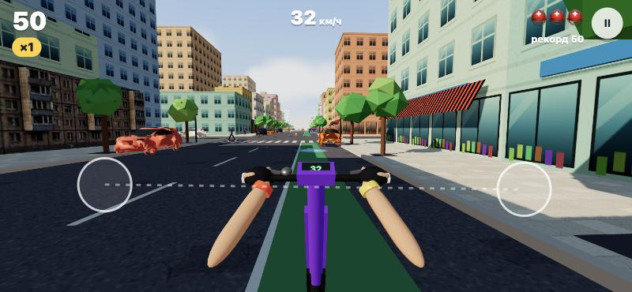
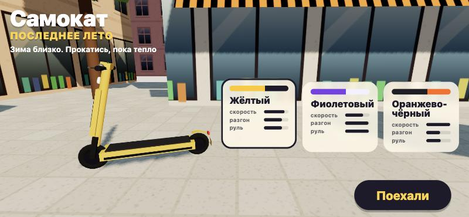

# Самокат. Последнее лето

Зима близко, полгода без кикшеринга. Поэтому вот симулятор летней езды на электросамокате от первого лица: Three.js, веб-билд под смартфон, горизонтальная ориентация.



## Как запустить

```bash
cd ~/Downloads/ПЕТ-ПРОЕКТЫ/Самокат
python3 -m http.server 5190
```

Открыть http://localhost:5190. Чтобы поиграть с телефона в той же Wi-Fi-сети, открой `http://<IP мака>:5190`. IP показывает команда `ipconfig getifaddr en0`.

Сборки нет: чистые ES-модули, three.js лежит локально в `vendor/`, интернет не нужен.

## Управление

**Телефон — руль двумя пальцами:**
- Поставь большие пальцы на левую и правую половину экрана, как на ручки руля. Пока держишь обе ручки, газ включается сам.
- Поворот — наклон линии между пальцами: левый палец вверх и правый вниз — направо, и наоборот. Руль в кадре поворачивается вслед за пальцами.
- Тормоз: потяни обе ручки на себя (оба пальца вниз) или просто отпусти руль.
- Поворот берётся из разницы высот пальцев, тормоз — из их общего сдвига вниз, поэтому одно не мешает другому.

**Клавиатура (для отладки):** ←/→ или A/D — руль, ↓/S/пробел — тормоз, газ автоматически. Esc — пауза.

## Что работает
- Меню: три самоката в раскрасках кикшерингов, у каждого свои характеристики.
  - **Жёлтый «Шмель»** — середнячок.
  - **Фиолетовый «Слива»** — вёрткий и резвый со старта, но медленнее на прямой.
  - **Оранжево-чёрный «Тигр»** — самый быстрый, но долго разгоняется и тяжело входит в поворот.
- Вид от первого лица: руль с дисплеем скорости, колонка, нос деки, переднее колесо и загорелые руки. Вьюмодель рисуется вторым проходом, поэтому не протыкает машины и стены. Наклон в повороте, FOV растёт со скоростью, на плитке трясёт сильнее, чем на асфальте.
- Бесконечная процедурная улица кусками по 60 м:
  - дома разной высоты с отступами, витринами, вывесками, маркизами, балконами с цветами и кондиционерами, иногда двор;
  - фоновые массивы на третьем плане, деревья и фонари;
  - велодорожка, разметка, тротуары с бордюрами;
  - каждые 180 м перекрёсток с зеброй, светофорами и поперечным потоком;
  - летние веранды кафе и тележки с мороженым.
- Лето: солнце сбоку-сзади, тёплый свет, тени домов и деревьев, небо с градиентом, солнечным ореолом и облаками, тёплая дымка.
- Препятствия:
  - **падение:** припаркованные и едущие машины (попутка, встречка, поперёк на перекрёстках), открытые люки, деревья, столбы, гидранты, урны, щитки, веранды;
  - **падение, люди и животные:** пешеходы, бабушки (иногда переходят где попало), собаки (выбегают поперёк);
  - **падение, дверь:** дверь машины распахивается прямо в велополосу, перед этим машина мигает аварийкой;
  - **штраф:** конусы (отлетают), бордюр не на зебре;
  - **без штрафа:** лужи (брызги и занос), голуби (разлетаются, «Кыш!» +10).
- Счёт:
  - метры × множитель; множитель растёт до ×5 за каждые 10 с чистой езды, штраф его сбрасывает;
  - «Впритирку!» +20 за проезд вплотную к препятствию;
  - 3 шлема-жизни, рекорд хранится в `localStorage`.
- Падение: камера заваливается, самокат кувыркается вперёд, вспышка, вибрация на Android. После падения 2,5 с неуязвимости.
- В вертикальной ориентации показывается «Поверни телефон», заезд встаёт на паузу. Пауза также включается при сворачивании вкладки. Кнопка «Поехали» на телефоне включает полный экран и пытается зафиксировать горизонтальную ориентацию.
- Звук синтезируется кодом: гул мотора, ветер, удары, звонок, голуби, лай.
- Производительность:
  - статика куска улицы слита в 4–5 мешей; машины и пропсы запечены в один меш с вертекс-цветами;
  - тени только от машин, людей, деревьев и домов, с картой, привязанной к игроку;
  - если кадр дольше 21 мс, игра сама снижает разрешение, затем качество теней;
  - на десктопе 55–60 fps, ~250 тыс. треугольников, ~300 вызовов отрисовки вместе с проходом теней. На настоящем телефоне ещё не мерили.



## Отладочные параметры URL
- `?play` — сразу в заезд; `?s=600` — старт с 600 м.
- `?auto` — автопилот; `?god` — без падений.
- `?perf` — fps, вызовы отрисовки и разрешение в заголовке вкладки.
- `?top` — камера сверху-сзади; `?slowcrash` — падение на 8 с.
- `?nopause` — не ставить на паузу в фоне и крутить цикл таймером (для скрытой вкладки).
- `tools/gallery.html` — все модели в ряд, `?b` — здания, `?top` — вид сверху.

## Структура
- `src/layout.js` — раскладка куска улицы, чистые данные без THREE.
- `src/world.js` — небо, солнце, сборка кусков.
- `src/actors.js` — конусы, двери, пешеходы, собаки, голуби, поток машин.
- `src/models.js` — процедурные модели, параметры самокатов.
- `src/assets.js` — загрузка GLB и запекание.
- `src/input.js` — руль двумя пальцами.
- `src/audio.js` — синтез звука.
- `src/main.js` — игра, камера, HUD.
- `assets/` — пережатые модели (~1,2 МБ). Откуда они и чьи — в [КРЕДИТЫ.md](КРЕДИТЫ.md).

## Что дальше
- Проверить на настоящем телефоне: удобство руля, fps. Если тормозит, снизить плотность машин и людей.
- Вписать авторов пяти зданий из «Курьера» (см. КРЕДИТЫ.md).
- Свои руки: сейчас загорелые предплечья без рукавов, можно добавить футболку и часы.
- Звонок, которым пугаешь пешеходов, бонусы (мороженое, кофе), дневной цикл до заката.
- Публикация на GitHub Pages — только после «да» Паши.
